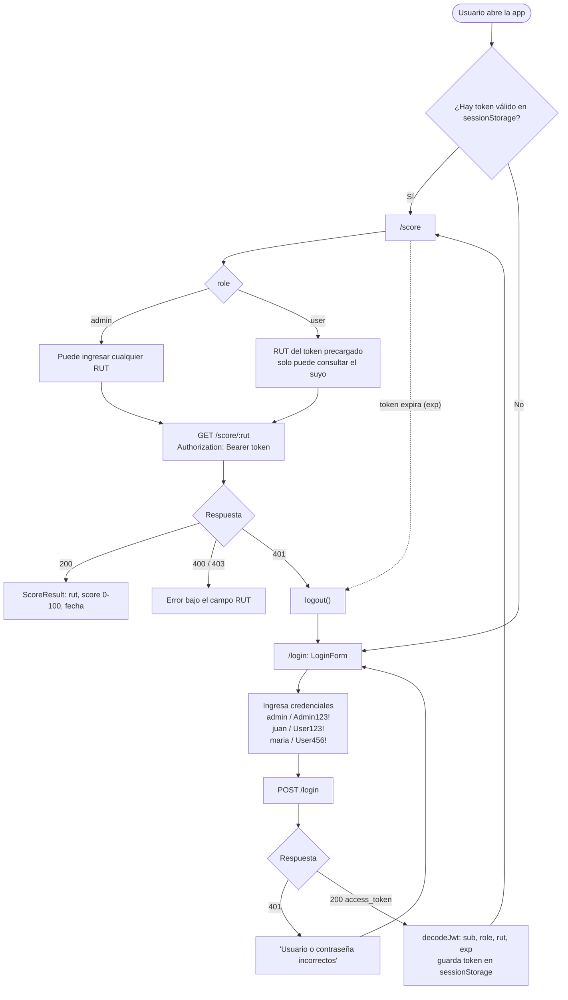

# Finance App — SPA (React)

SPA en React + TypeScript que permite iniciar sesión contra la API de `finance-app` y consultar el score financiero de un RUT según el rol del usuario.

## Tecnologías

| Tecnología | Uso |
|---|---|
| React 19 + TypeScript | UI y tipado |
| Vite 8 | Dev server y build |
| Bun | Gestor de paquetes y ejecución de scripts |
| React Router 7 | Rutas `/login` y `/score`, ruta protegida |
| shadcn/ui (Base UI) + Tailwind CSS 4 | Componentes (`Button`, `Card`, `Input`, `Label`) y estilos |
| React Hook Form | Formulario y validaciones de RUT |
| lucide-react | Íconos |
| ESLint + Prettier | Lint y formato |

## Cómo levantar el proyecto

Requisitos: [Bun](https://bun.sh) y el backend `finance-app` corriendo (por defecto en `http://localhost:3000`).

```bash
bun install
cp .env.example .env    # VITE_API_URL=http://localhost:3000
bun run dev             # http://localhost:5173
```

El backend permite por CORS el origen `http://localhost:5173` (variable `FRONTEND_URL` del backend). Si cambias el puerto de Vite, actualízala allá.

Otros scripts:

```bash
bun run build       # tsc -b + vite build -> dist/
bun run preview     # sirve el build
bun run typecheck   # tsc --noEmit
bun run lint        # eslint
```

## Credenciales de prueba

| Usuario | Contraseña | Rol | RUT | Puede consultar |
|---|---|---|---|---|
| `admin` | `Admin123!` | admin | — | Cualquier RUT válido |
| `juan` | `User123!` | user | `12.345.678-5` | Solo `12.345.678-5` |
| `maria` | `User456!` | user | `11.111.111-1` | Solo `11.111.111-1` |

## Flujo de login y consulta



## Cómo funciona la sesión

- `AuthProvider` (`src/context/auth-context.tsx`) llama a `POST /login`, decodifica el JWT y guarda el token en `sessionStorage` (se borra al cerrar la pestaña). Programa un `setTimeout` que cierra la sesión cuando llega `exp`.
- `decodeJwt` (`src/lib/jwt.ts`) solo **lee** el payload para la UI (rol, RUT, expiración); no verifica la firma. La seguridad real está en el backend, que valida firma, expiración y permisos en cada request.
- `ProtectedRoute` redirige a `/login` si no hay sesión y recuerda la ruta que se intentó abrir.
- `ScoreLookup` replica la regla de `RutOwnershipGuard` (un `user` solo consulta su RUT) para dar feedback inmediato, y valida el formato del RUT; el dígito verificador lo valida el backend (`400`).
- Un `401` en `GET /score/:rut` (token vencido o inválido) cierra la sesión y vuelve al login.

## Estructura

```
src/
├── main.tsx                     # monta ThemeProvider + App
├── App.tsx                      # AuthProvider + rutas (/login, /score)
├── components/
│   ├── protected-route.tsx      # guard de UI por sesión y rol
│   ├── theme-provider.tsx
│   └── ui/                      # componentes shadcn
├── context/auth-context.tsx     # estado de sesión, login, logout, expiración
├── hooks/authentication.ts      # useAuthentication()
├── lib/
│   ├── api.ts                   # cliente fetch: login(), getScore(), ApiError
│   ├── jwt.ts                   # decodeJwt(), isExpired()
│   ├── rut.ts                   # formato, normalización y regex de RUT
│   └── utils.ts
├── pages/                       # componentes de ruta
│   ├── auth/LoginPage.tsx
│   └── score/ScorePage.tsx      # header con rol/RUT y logout
└── views/                       # vistas con la lógica de cada pantalla
    ├── auth/LoginForm.tsx
    └── score/
        ├── ScoreLookup.tsx      # formulario de RUT + llamada a la API
        └── ScoreResult.tsx      # score, barra de progreso y fecha
```

Para agregar componentes shadcn: `bunx shadcn@latest add <componente>`.

## Uso de herramientas de IA

El detalle de qué herramientas se usaron y qué partes del código apoyaron está en [ai_interactions.md](./ai_interactions.md).
